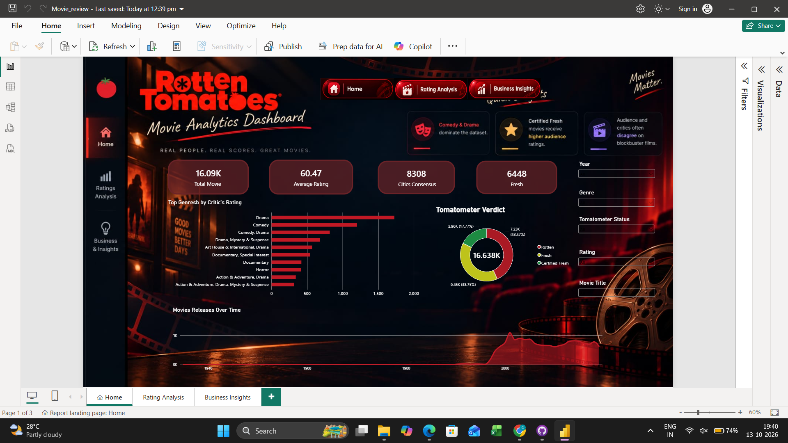
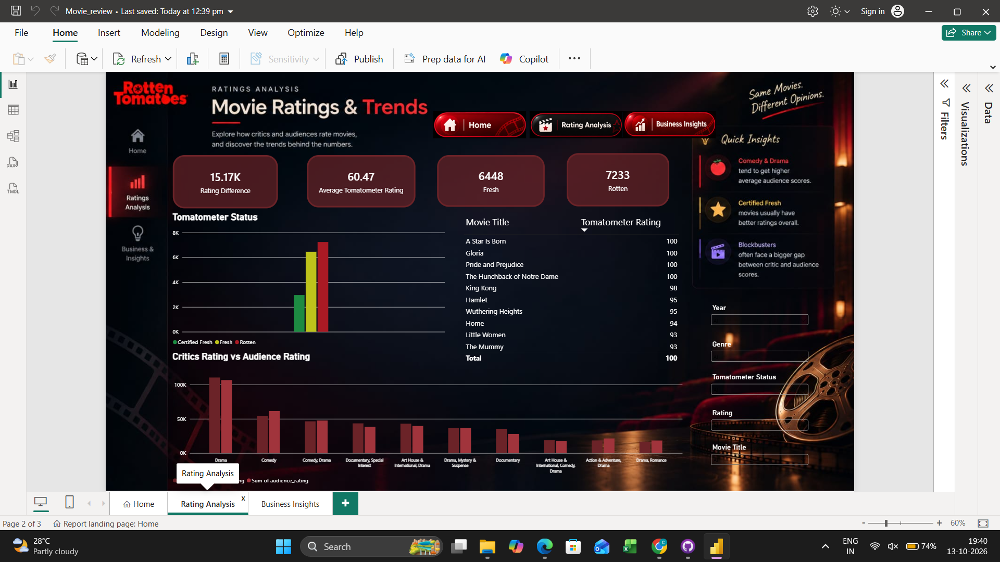
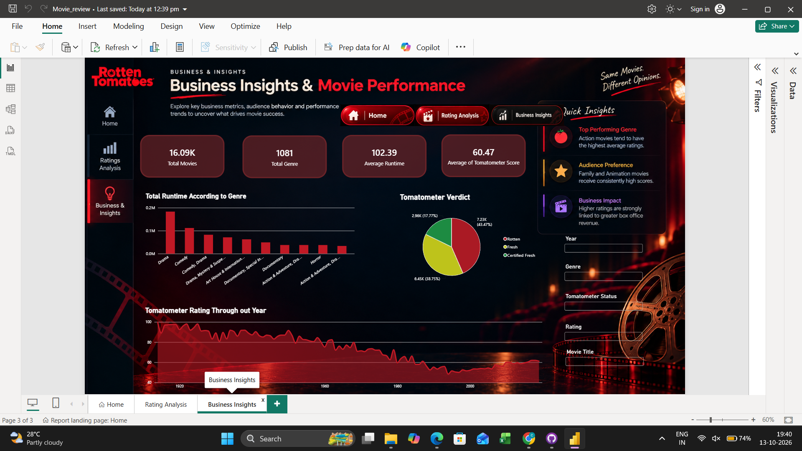

# 🎬 Movie Ratings & Business Insights Dashboard

> An interactive, three-page Power BI report inspired by Rotten Tomatoes. Explore movie ratings, genre patterns, critics-versus-audience ratings, verdict distributions, and business-oriented insights through a cinematic dashboard design.

---

## 🖼️ Full Dashboard Preview

The images below show the three pages of the dashboard as they appear in Power BI Desktop.

### Page 1 — Home: Movie Analytics


### Page 2 — Rating Analysis


### Page 3 — Business Insights


---

## 📖 Project Overview

The **Movie Ratings & Business Insights Dashboard** is a Power BI project created to make a movie dataset easier to explore visually. It brings together high-level KPIs, genre comparisons, movie verdicts, ratings, and trends over time in a single report.

The report is organized into three pages:
- **Home** provides an overview of movie data and the distribution of Tomatometer verdicts.
- **Rating Analysis** focuses on movie ratings, rating differences, and comparisons across genres.
- **Business Insights** explores runtime, genre performance, and rating trends.

The dashboard uses a consistent dark, cinematic look with red highlights, movie-themed imagery, KPI cards, charts, slicers, and page-navigation controls.

## 🎯 Project Objectives

- Summarize the movie dataset using key performance indicators.
- Explore how ratings vary by genre.
- Compare critics' ratings with audience ratings.
- Understand the distribution of Rotten, Fresh, and Certified Fresh verdicts.
- Examine movie-related patterns and trends over time.
- Make the report easier to explore through filters and page navigation.
- Present data in a clear and visually engaging format.

## 📄 Dashboard Walkthrough

### 1. Home — Movie Analytics

The Home page acts as the report's starting point and provides a broad overview.

**Key elements**
- KPI cards for total movies, average rating, critics' consensus, and Fresh movies.
- A horizontal bar chart showing top genres by critics' rating.
- A donut chart showing the distribution of Tomatometer verdicts.
- A time-based visual showing movie releases over time.
- Slicers for year, genre, Tomatometer status, rating, and movie title.
- Navigation buttons linking to the Rating Analysis and Business Insights pages.

**Questions this page helps explore**
- Which genres appear most prominently in the dataset?
- How are movie verdicts distributed?
- How does the number of movie releases change over time?

### 2. Rating Analysis

The Rating Analysis page focuses on rating comparisons and individual movie scores.

**Key elements**
- KPI cards for rating difference, average Tomatometer rating, Fresh movies, and Rotten movies.
- A chart comparing the counts of Certified Fresh, Fresh, and Rotten movies.
- A table listing movie titles and Tomatometer ratings.
- A comparison of critics' ratings and audience ratings across genres.
- Quick-insight callouts that summarize selected rating patterns.
- The same report filters for interactive exploration.

**Questions this page helps explore**
- How do ratings differ across genres?
- How do critics' and audience ratings compare?
- Which listed movies have high Tomatometer ratings?
- How does the distribution of movie verdicts look?

### 3. Business Insights

The Business Insights page presents a broader view of movie characteristics and performance patterns.

**Key elements**
- KPI cards for total movies, total genres, average runtime, and average Tomatometer score.
- A bar chart showing total runtime by genre.
- A donut chart showing the distribution of Tomatometer verdicts.
- A time-series visual showing Tomatometer rating trends over time.
- Quick-insight callouts related to genre performance and audience preferences.
- Filters that let viewers narrow the report to selected movies, genres, years, and ratings.

**Questions this page helps explore**
- Which genres contribute the most total runtime in the dataset?
- How are verdicts distributed across the dataset?
- How do ratings change across the years shown in the report?
- What patterns may be useful for further movie-performance analysis?

## 📊 KPIs at a Glance

The report includes KPI cards such as:
- **Total Movies**
- **Average Rating / Average Tomatometer Rating**
- **Critics Consensus**
- **Fresh Movies**
- **Rotten Movies**
- **Rating Difference**
- **Total Genres**
- **Average Runtime**
- **Average Tomatometer Score**

The KPI cards vary by page so each page can focus on a different aspect of the dataset.

## 🧰 Tools & Power BI Features

- **Microsoft Power BI Desktop** — report creation and data visualization.
- **KPI cards** — display key summary values.
- **Bar charts** — compare genres and categories.
- **Donut chart** — show the distribution of movie verdicts.
- **Time-trend visuals** — show patterns across years.
- **Table visual** — display movie titles and ratings.
- **Slicers/filters** — let viewers interact with the report.
- **Page navigation** — move between the three dashboard pages.

## 🧭 How to Explore the Dashboard

1. Open `Movie_review.pbix` in Microsoft Power BI Desktop.
2. Start on the **Home** page for the overall view.
3. Use the navigation buttons or the page tabs to open **Rating Analysis** and **Business Insights**.
4. Apply the slicers to filter by year, genre, verdict, rating, or movie title.
5. Compare how the visuals respond to different filter selections.

## 📂 Repository Structure

Upload the following files to the **same root folder** of your GitHub repository:

```text
Movie-Ratings-Dashboard/
├── Movie_review.pbix
├── README.md
├── page_1.png
├── page_2.png
└── page_3.png
```

**Screenshot setup:** The three image links in this README expect the files to be named `page_1.png`, `page_2.png`, and `page_3.png`. Keep those filenames exactly the same and upload them beside `README.md` so GitHub can render the images.

## 💡 What This Project Demonstrates

- Designing a multi-page interactive Power BI report.
- Presenting movie data through KPIs and complementary chart types.
- Comparing ratings and genre-level patterns.
- Using slicers and navigation to support exploration.
- Organizing a dashboard around distinct analytical goals: overview, rating analysis, and business insights.

## 🔮 Possible Future Improvements

- Add a dedicated page for the biggest critic-versus-audience rating gaps.
- Include more detailed genre and year comparisons.
- Add drill-through pages for individual movie details.
- Improve tooltip pages to show extra context when hovering over charts.
- Add a data-refresh workflow if the source data is updated regularly.

---

**Created with Microsoft Power BI**  
*Movie Analytics • Rating Trends • Business Insights*
